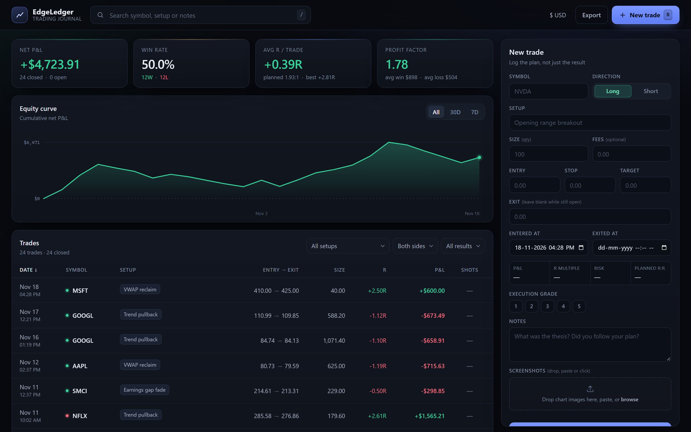

# EdgeLedger

**Track your trades. Measure your edge. Improve your execution.**

EdgeLedger is a personal trading journal designed to help traders record their trades, review their performance, and build better trading habits through consistent tracking and analysis.

## Overview

Trading isn't just about entering and exiting the market. It's about understanding your decisions, tracking your results, and learning from every trade.

EdgeLedger provides a simple way to maintain your trading records in one place.

## Features

- 📝 Record and manage trading entries
- 📊 Track your trading performance
- 📈 Review wins and losses
- 📚 Maintain a personal trading history
- 💾 Local SQLite database storage
- 🖥️ Simple web-based interface
- 🔒 Local-first application

## Screenshots



## Tech Stack

- **Backend:** Node.js
- **Frontend:** HTML, CSS, JavaScript
- **Database:** SQLite

## Getting Started

### Prerequisites

- [Node.js](https://nodejs.org/) installed on your computer

### Installation

Clone the repository:

```bash
git clone https://github.com/pavan20006/edgeledger.git
```

Navigate into the project directory:

```bash
cd edgeledger
```

Install dependencies:

```bash
npm install
```

### Run EdgeLedger

```bash
npm start
```

Alternatively, on Windows, you can use:

```text
start.cmd
```

Open your browser and visit:

```text
http://127.0.0.1:4173
```

## Project Structure

```text
EdgeLedger/
├── docs/
│   └── screenshot.png
├── public/
│   ├── app.js
│   ├── index.html
│   └── styles.css
├── .gitignore
├── package.json
├── server.js
├── start.cmd
└── README.md
```

## Philosophy

**Trade. Record. Review. Improve.**

A trader who reviews their decisions can learn from their mistakes, recognize patterns, and work toward more consistent execution.

## Disclaimer

EdgeLedger is a trading journal and record-keeping tool. It does not provide financial advice, trading signals, or guarantee trading profits.

---

Made with ❤️ for traders who want to improve.

